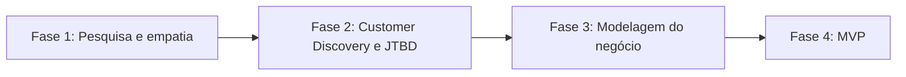

# Portfólio Acadêmico: Pedro Henrique Maciel

Repositório com minhas atividades das Unidades Curriculares (UCs) e do Projeto Integrador (PI) do semestre 2026.2, organizado com conceitos de Arquitetura da Informação.

## Sobre mim

Sou **Pedro Henrique Maciel**, estudante de **Análise e Desenvolvimento de Sistemas** no Senac.

- Turma: [PREENCHER]
- GitHub: [@Pedro-Maciel77](https://github.com/Pedro-Maciel77)
- LinkedIn: [PREENCHER]
- Sobre o que eu gosto de estudar: [PREENCHER: 1 ou 2 frases]

## Comece por aqui

| Quero... | Vá em... |
|----------|----------|
| Ver o Projeto Integrador | [pi-altura](pi-altura/README.md) |
| Ver minhas atividades por UC | [ucs](ucs/README.md) |
| Ver tudo o que existe | [Sumário geral](SUMARIO.md) |
| Buscar por assunto, tipo ou tag | [Índice de busca](INDEX.md) |
| Entender um termo | [Glossário](GLOSSARIO.md) |
| Saber como o repositório foi organizado | [Arquitetura da Informação](docs/arquitetura-da-informacao.md) |
| Adicionar uma atividade nova | [Como contribuir](CONTRIBUINDO.md) |

## O que é do grupo e o que é meu

| Conteúdo | Autoria | Onde |
|----------|---------|------|
| Documentos e código do PI | **Grupo** (equipe Altura). Cada documento tem a seção "Minha contribuição" | `pi-altura/` |
| Atividades das UCs | **Minhas** (individuais) | `ucs/` |
| Organização do repositório e documentação de Arquitetura da Informação | **Minha** | `docs/`, índices, taxonomia |

## Projeto Integrador: Altura

O **Altura** (antes chamado NEXO) é uma plataforma web/PWA de **matchmaking entre startups e investidores**, com economia de tempo e mais alcance de conexões. O diferencial é um algoritmo que calcula a **% de compatibilidade** entre startup e investidor. O modelo de receita nos canvas é uma taxa de comissão quando o investimento é fechado.

- **Persona:** Marina Duarte, 27 anos, fundadora de startup em Recife, sem rede de contatos no ecossistema de investimentos.
- **Stack:** React 19, TypeScript e Vite no front-end (interface pronta, com dados simulados); Node.js no back-end e banco de dados em desenvolvimento. Planejamos seguir a LGPD.
- **Equipe:** Pedro Henrique Maciel, Hugo Dantas, Roberto Alves, Cleybson Teixeira, Ezequiel Borges e Eduardo Soares.
- **Código:** [repositório NEXO](https://github.com/Pedro-Maciel77/nexo), pasta `app/`.



### Documentos do PI

| Nº | Documento | Fase |
|----|-----------|------|
| 01 | [Pesquisa Inicial](pi-altura/01-pesquisa-e-empatia/01-pesquisa-inicial.md) | Pesquisa e empatia |
| 02 | [Mapa de Empatia (público: startups)](pi-altura/01-pesquisa-e-empatia/02-mapa-de-empatia.md) | Pesquisa e empatia |
| 03 | [Plano de Pesquisa](pi-altura/01-pesquisa-e-empatia/03-plano-de-pesquisa.md) | Pesquisa e empatia |
| 04 | [Template de Persona: Marina Duarte](pi-altura/01-pesquisa-e-empatia/04-persona-marina-duarte.md) | Pesquisa e empatia |
| 05 | [Resposta da Equipe (tabela de dimensões)](pi-altura/01-pesquisa-e-empatia/05-resposta-da-equipe.md) | Pesquisa e empatia |
| 06 | [Questionário de Customer Discovery e JTBD (Aula 4)](pi-altura/02-customer-discovery/06-questionario-customer-discovery-jtbd.md) | Customer Discovery |
| 07 | [Formulário para fundadores (Google Forms)](pi-altura/02-customer-discovery/07-formulario-fundadores.md) | Customer Discovery |
| 08 | [Business Model Canvas](pi-altura/03-modelagem-de-negocio/08-business-model-canvas.md) | Modelagem do negócio |
| 09 | [Lean Canvas](pi-altura/03-modelagem-de-negocio/09-lean-canvas.md) | Modelagem do negócio |
| 10 | [Código do MVP (pasta app/ do repositório NEXO)](pi-altura/04-mvp/10-codigo-do-mvp.md) | MVP |

Veja também o [mapa de relações entre os documentos](docs/relacoes.md).

## Unidades Curriculares do semestre

| UC | Atividades | Relação com o PI |
|----|------------|------------------|
| [FullStack](ucs/fullstack/README.md) | [PREENCHER] | Desenvolvimento do MVP |
| [Empreendedorismo e Plano de Negócios](ucs/empreendedorismo-plano-de-negocios/README.md) | [PREENCHER] | Aula 4: Customer Discovery e JTBD |
| [PREENCHER: outras UCs] | [PREENCHER] | [PREENCHER] |

## Estrutura do repositório

```
portfolio-academico/
├── README.md, SUMARIO.md, INDEX.md, GLOSSARIO.md, CONTRIBUINDO.md
├── catalogo.yml, taxonomia.yml
├── docs/            explicação da Arquitetura da Informação
├── ucs/             atividades individuais, uma pasta por UC
├── pi-altura/       Projeto Integrador, uma pasta por fase
├── templates/       modelos para documentos novos
└── scripts/         gera índices e valida o repositório
```

A justificativa da organização está em [Classificação e estrutura de pastas](docs/classificacao.md).

## Palavras-chave

portfólio acadêmico · Projeto Integrador · Altura · NEXO · Senac · FullStack · Empreendedorismo · startups · investidores · matchmaking · persona · mapa de empatia · Customer Discovery · Jobs to Be Done · Business Model Canvas · Lean Canvas · MVP · PWA · React · TypeScript · Node.js · LGPD · Arquitetura da Informação
