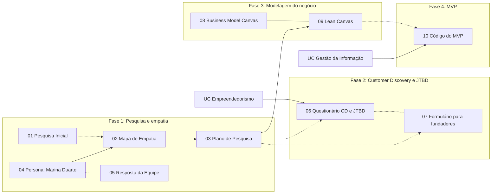

# Relações entre conteúdos (mapa em Mermaid)

## Mapa

## Como ler

- **Linha cheia (`-->`)**: relação direta. A cadeia principal é **Persona → Mapa de Empatia → Plano de Pesquisa → Lean Canvas**: persona e mapa descrevem o mesmo público, o plano de pesquisa parte desse público e a pesquisa alimenta o canvas. Os dois canvases também ficam ligados entre si, e cada UC se liga ao documento do PI que nasceu nela.
- **Linha pontilhada (`-.->`)**: relação provável, de acordo com o fluxo do PI. [PREENCHER: confirme ou corrija cada uma.]

## Tabela de relações

| De | Para | Por quê |
|----|------|---------|
| [Persona](../pi-altura/01-pesquisa-e-empatia/04-persona-marina-duarte.md) | [Mapa de Empatia](../pi-altura/01-pesquisa-e-empatia/02-mapa-de-empatia.md) | Persona e mapa descrevem o mesmo público (startups) |
| [Mapa de Empatia](../pi-altura/01-pesquisa-e-empatia/02-mapa-de-empatia.md) | [Plano de Pesquisa](../pi-altura/01-pesquisa-e-empatia/03-plano-de-pesquisa.md) | O plano parte do público descrito no mapa |
| [Plano de Pesquisa](../pi-altura/01-pesquisa-e-empatia/03-plano-de-pesquisa.md) | [Lean Canvas](../pi-altura/03-modelagem-de-negocio/09-lean-canvas.md) | A pesquisa dá base ao canvas |
| [Business Model Canvas](../pi-altura/03-modelagem-de-negocio/08-business-model-canvas.md) | [Lean Canvas](../pi-altura/03-modelagem-de-negocio/09-lean-canvas.md) | Dois canvases do mesmo negócio |
| [UC Empreendedorismo](../ucs/empreendedorismo/README.md) | [Questionário CD e JTBD](../pi-altura/02-customer-discovery/06-questionario-customer-discovery-jtbd.md) | Feito a partir da aula 4 |
| [UC Gestão da Informação](../ucs/gestao-da-informacao/README.md) | [Código do MVP](../pi-altura/04-mvp/10-codigo-do-mvp.md) | O MVP é desenvolvido nesta UC |

A lista completa, gerada dos metadados, está no [INDEX.md](../INDEX.md#relações-entre-documentos).

## Como adicionar uma relação

1. Em cada um dos dois documentos, acrescente o `id` do outro em `relacionados`.
2. Acrescente um item na seção "Relações" do documento, com link e o motivo.
3. Acrescente a linha no mapa acima.
4. Rode `python scripts/atualizar.py`.

---

[← Anterior: Encontrabilidade](encontrabilidade.md) | [↑ README](../README.md) | [Próximo: Passo a passo do git →](passo-a-passo-git.md)
