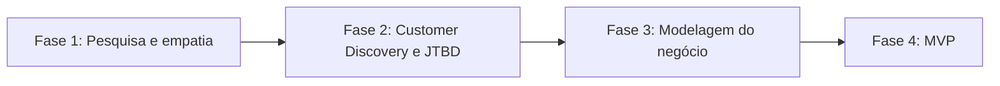

# Projeto Integrador: Altura

O Projeto Integrador (PI) é um trabalho **em grupo** do curso do Senac (semestre 2026.2). Ele junta o que aprendemos nas várias UCs em um único produto, do problema até a solução.

> **Atenção:** o PI é um trabalho em grupo. Os documentos apresentam o conteúdo registrado pela equipe Altura.

## Sobre o Altura

O Altura (antes chamado NEXO) é uma plataforma web/PWA de matchmaking entre startups e investidores, com economia de tempo e mais alcance de conexões. O diferencial é um algoritmo que calcula a **% de compatibilidade** entre startup e investidor. O modelo de receita nos canvas é uma taxa de comissão quando o investimento é fechado.

- **Persona:** [Marina Duarte](01-pesquisa-e-empatia/04-persona-marina-duarte.md), 27 anos, fundadora de startup em Recife, sem rede de contatos no ecossistema de investimentos.
- **Stack:** React 19, TypeScript e Vite no front-end (interface pronta, com dados simulados); Node.js no back-end e banco de dados em desenvolvimento. Planejamos seguir a LGPD.
- **Código:** [repositório NEXO](https://github.com/Pedro-Maciel77/nexo), pasta `app/`.

## Integrantes

O projeto foi desenvolvido em grupo pelos seguintes integrantes, sem atribuição de funções neste portfólio:

- Pedro Henrique Maciel
- Hugo Dantas
- Roberto Alves
- Cleybson Teixeira
- Ezequiel Borges
- Eduardo Soares

## Como o PI está organizado

O PI segue 4 fases, na ordem em que o grupo trabalhou:

## Atividade de Gestão da Informação ligada ao PI

- [Radar de problemas informacionais — Altura](../ucs/gestao-da-informacao/01-radar-problemas-informacionais-altura.md): registra os problemas informacionais relativos aos perfis, aos critérios de compatibilidade e aos indicadores do produto.

## Fase 1: Pesquisa e empatia

| Nº | Documento | Tipo |
|----|-----------|------|
| 01 | [Pesquisa Inicial](01-pesquisa-e-empatia/01-pesquisa-inicial.md) | pesquisa |
| 02 | [Mapa de Empatia (público: startups)](01-pesquisa-e-empatia/02-mapa-de-empatia.md) | mapa-de-empatia |
| 03 | [Plano de Pesquisa](01-pesquisa-e-empatia/03-plano-de-pesquisa.md) | plano |
| 04 | [Template de Persona: Marina Duarte](01-pesquisa-e-empatia/04-persona-marina-duarte.md) | persona |
| 05 | [Resposta da Equipe (tabela de dimensões)](01-pesquisa-e-empatia/05-resposta-da-equipe.md) | tabela |

## Fase 2: Customer Discovery e JTBD

| Nº | Documento | Tipo |
|----|-----------|------|
| 06 | [Questionário de Customer Discovery e JTBD (Aula 4)](02-customer-discovery/06-questionario-customer-discovery-jtbd.md) | questionario |
| 07 | [Formulário para fundadores (Google Forms)](02-customer-discovery/07-formulario-fundadores.md) | formulario |

## Fase 3: Modelagem do negócio

| Nº | Documento | Tipo |
|----|-----------|------|
| 08 | [Business Model Canvas](03-modelagem-de-negocio/08-business-model-canvas.md) | canvas |
| 09 | [Lean Canvas](03-modelagem-de-negocio/09-lean-canvas.md) | canvas |

## Fase 4: MVP

| Nº | Documento | Tipo |
|----|-----------|------|
| 10 | [Código do MVP (pasta app/ do repositório NEXO)](04-mvp/10-codigo-do-mvp.md) | codigo |

## Relações entre os documentos

Veja o [mapa de relações](../docs/relacoes.md) para entender como os documentos se ligam (por exemplo: Persona → Mapa de Empatia → Plano de Pesquisa → Lean Canvas).

## UCs ligadas ao PI

- [Empreendedorismo](../ucs/empreendedorismo/README.md): aula 4 de Customer Discovery e JTBD.

---

[← README principal](../README.md) | [Índice de UCs →](../ucs/README.md) | [Sumário geral](../SUMARIO.md)
